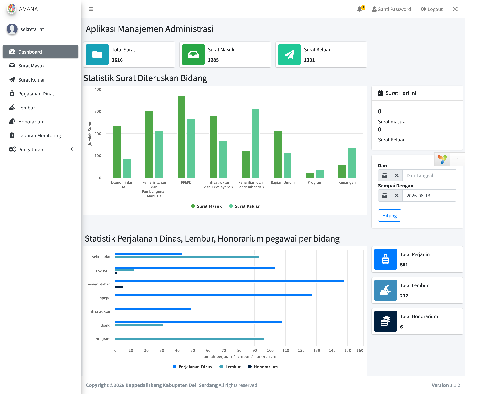
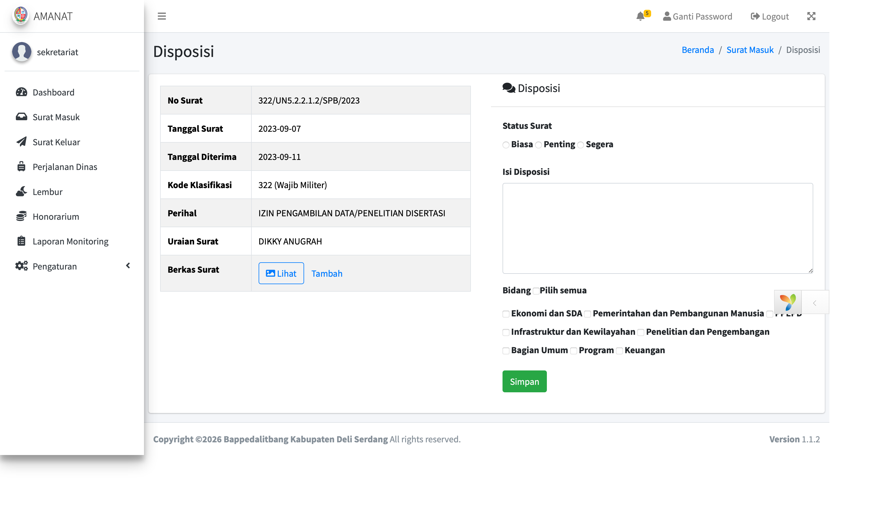

# 📋 AMANAT — Aplikasi Manajemen Administrasi Pemerintah Daerah

Sistem informasi untuk mengelola administrasi internal instansi pemerintah daerah, mencakup **Surat-Menyurat**, **Lembur**, **Perjalanan Dinas**, dan **Honorarium** dalam satu platform terintegrasi.

## ✨ Fitur Utama

- **Surat-Menyurat** — pencatatan dan pengelolaan surat masuk/keluar

- **Lembur** — pengajuan dan rekap jam kerja lembur pegawai

- **Perjalanan Dinas** — pengelolaan Surat Perintah Tugas (SPT) dan perjalanan dinas pegawai
- **Honorarium** — pencatatan dan perhitungan honorarium

## 🛠️ Tech Stack

- **Framework:** PHP — Yii 2 Framework
- **Database:** MySQL
- **Dev Environment:** Docker / Docker Compose, Vagrant

## 🧱 Struktur Proyek

Mengikuti struktur standar Yii2 Advanced Template:

common/         konfigurasi & model yang dipakai bersama (frontend & backend)
console/        console commands & migration database
frontend/       aplikasi Web untuk pengguna/pegawai
manajemen/      aplikasi Web untuk admin/pengelola
environments/   konfigurasi berdasarkan environment (dev/prod)
vagrant/        konfigurasi Vagrant untuk dev environment

## 🚀 Instalasi

1. Clone repository:
   bash
   git clone https://github.com/noeta92/amanat-php.git
   cd amanat-php
   
2. Install dependency via Composer:
   bash
   composer install

3. Inisialisasi environment (pilih \`dev\` atau \`prod\`):
   bash
   php init
   
4. Import database dari 'amanat.sql' ke MySQL, lalu sesuaikan koneksi database di common/config/main-local.php.
5. Jalankan migration (jika diperlukan):
   bash
   php yii migrate
   
6. **Opsional — jalankan via Docker:**
   bash
   docker-compose up -d

### Keamanan berkas surat masuk

Berkas baru disimpan di `common/uploads/surat-masuk`, di luar document root, dan
diakses melalui aplikasi. Pastikan direktori tersebut dapat ditulis oleh PHP,
tidak disajikan oleh web server, dan termasuk dalam backup.

**Sebelum menggunakan versi ini pada instalasi yang sudah ada**, hentikan akses
ke aplikasi, backup berkas, lalu pindahkan berkas lama dari
`frontend/web/dok/masuk` ke `common/uploads/surat-masuk` dengan nama yang sama.
Jangan menimpa berkas yang sudah ada; selesaikan setiap konflik nama terlebih
dahulu. Pastikan semua berkas lama sudah dipindahkan dan hapus salinan publiknya
sebelum membuka aplikasi kembali.

`.htaccess` disertakan sebagai perlindungan tambahan untuk Apache yang
mengizinkannya. Pada Nginx atau server lain, konfigurasi server juga harus
menolak akses langsung ke `/dok/masuk/`; jangan mengandalkan `.htaccess`.
Pastikan pembatasan ini aktif dan direktori `common/uploads` tidak dapat diakses
melalui web. Modul lain masih memerlukan peninjauan kontrol akses tersendiri.

Hak akses surat masuk mengikuti izin rute RBAC yang sudah dikonfigurasi.
Pengguna Kabid dan Keuangan hanya dapat membuka surat yang ditugaskan ke
bidangnya; admin, Kaban, dan Super Admin tetap mengikuti izin rutenya.
   

## 📄 Lisensi dan Copyright

Proyek ini dilisensikan di bawah **BSD-3-Clause License**. Lihat [LICENSE.md](./LICENSE.md) untuk detail. Contributed by Noeta92.